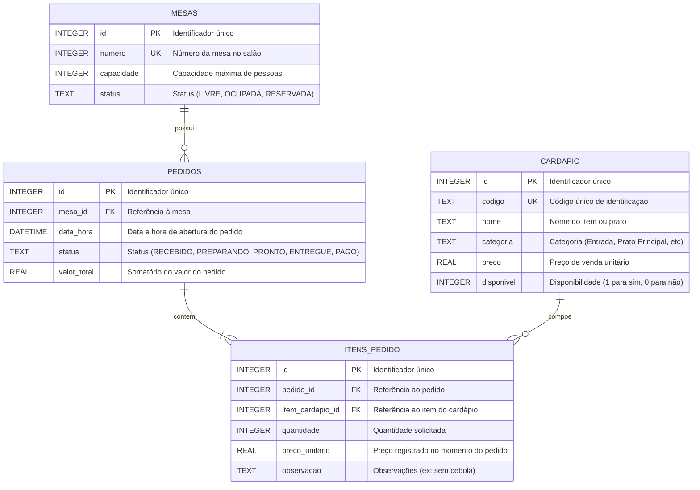

# GastroFlow (Sistema Inteligente de Gerenciamento de Pedidos, Mesas e Cozinhas para Restaurantes)

Usar Prompts Estruturadso para Criação de todas as etapas do desenvolvimento

## Prompt de Inicialização do Projeto (Arquitetura)

Você é um Arquiteto de Software sênior especialista no Google Antigravity.
Gere a estrutura inicial de diretórios para um sistema de gestão de restaurante chamado 'gastroflow'.
Requisitos obrigatórios:
1. Crie a pasta de configuração '.antigravity/' contendo as subpastas 'agents', 'skills' e 'logs'.
2. Crie a pasta 'src/' modularizada em 'config', 'models' e 'services'.
3. Crie a pasta 'tests/' para testes automatizados com pytest.
4. Gere o arquivo '.gitignore' bloqueando arquivos .env, bancos .sqlite e logs.
5. Gere o arquivo '.env.example' com as variáveis DB_PATH, APP_ENV e PORT sem expor valores confidenciais.
Execute os comandos bash para criação de arquivos e pastas


## Diagrama de Entidade-Relacionamento (DER)



## Prompt para Cria o Schema do Banco de Dados

Atue como Especialista em Banco de Dados Relacional.
Gere o script SQL para inicializar o banco 'restaurante.sqlite' com as seguintes tabelas:
1. 'cardapio': id, codigo (único), nome, categoria, preco, disponivel (booleano).
2. 'mesas': id, numero (único), capacidade, status (LIVRE, OCUPADA, RESERVADA).
3. 'pedidos': id, mesa_id, data_hora, status (RECEBIDO, PREPARANDO, PRONTO, ENTREGUE, PAGO), valor_total.
4. 'itens_pedido': id, pedido_id, item_cardapio_id, quantidade, preco_unitario, observacao.
Inclua as chaves estrangeiras e índices necessários para consultas rápidas.
Crie Tambem o Diagrama de Entidades Relacionais no README.md

## Configurar MCP, Agentes e Skills

### Configurando MCPs e elementos de Segurança (Prompt)

Você é um Especialista em Segurança e Integração do Google Antigravity.
Gere o arquivo '.antigravity/config.json' para o projeto 'GastroFlow'.
Regras mandatórias:
1. Configure o MCP 'database' usando o pacote oficial '@modelcontextprotocol/server-sqlite' apontando para o banco './src/database/restaurante.sqlite'. O caminho deve utilizar a variável de ambiente ${DB_PATH}.
2. Configure o MCP 'filesystem' usando '@modelcontextprotocol/server-filesystem' monitorando a pasta './src'.
3. Configure o MCP 'git' usando '@modelcontextprotocol/server-git' para auditoria de versões.
4. Ative a política de Human-in-the-Loop (humanInTheLoop) exigindo autorização humana explícita antes de qualquer 'database_write', 'file_delete' ou 'terminal_execute'.
5. Habilite o log de auditoria em '.antigravity/logs/audit.log'.
Retorne o JSON estritamente válido.

### Configuração dos Agentes 

#### Prompt para Construção do Agente de Atendimento ao cliente (maitre)

Crie a definição do Agente Maitre no arquivo '.antigravity/agents/maitre.json'.
Papel: Recepcionar pedidos dos clientes, verificar disponibilidade de mesas e validar se os pratos solicitados estão ativos no cardápio.
Permissões MCP: 'database' (somente leitura para mesas e cardápio, escrita com confirmação para pedidos).
Instruções de sistema obrigatórias:
- Sempre consulte a tabela 'mesas' antes de lançar pedidos em uma mesa.
- Verifique se os itens solicitados possuem 'disponivel = 1' na tabela 'cardapio'.
- Nunca exclua pedidos já lançados; altere apenas o status para 'CANCELADO'.
- Responda cordialmente em português (pt-BR).

**Testando o Agente**

"@AgenteMaitre, verifique via MCP database a situação da Mesa 4. Se estiver livre, abra um pedido contendo 2 unidades do prato 'RIS-01' (Risoto de Funghi) e 1 unidade da bebida 'SUC-02' (Suco de Maracujá). Apresente o resumo com valores antes de gravar."


#### Prompt para Criação do Agente Chef

Gere a especificação do Agente Chef no arquivo '.antigravity/agents/chef.json'.
Papel: Monitorar a fila de pedidos na cozinha, priorizar preparações por ordem de chegada e atualizar o status dos pedidos para 'PREPARANDO' ou 'PRONTO'.
Permissões MCP: 'database'.
Instruções de sistema:
- Monitore apenas pedidos com status 'RECEBIDO' ou 'PREPARANDO'.
- Sinalize observações especiais de clientes (ex: 'sem cebola', 'alérgico a glúten').
- Ao concluir a preparação de todos os itens de uma comanda, atualize o status para 'PRONTO'.
- Idioma de interação: pt-BR.

**Teste Para o Agente @chef**

@AgenteChef, consulte a fila de pedidos pendentes na cozinha via MCP Database. Liste os pratos a serem preparados, identificando número da mesa, horário do pedido e observações alimentares.

#### Prompt para Criação do Agente Caixa e Fechamento Financeiro (caixa.json)

Crie o arquivo de definição '.antigravity/agents/caixa.json'.
Papel: Fechar contas das mesas, calcular o valor total com taxa de serviço opcional (10%), aplicar descontos autorizados e marcar pedidos como 'PAGO'.
Permissões MCP: 'database'.
Instruções:
- Recupere todos os itens da comanda da mesa solicitada.
- Apresente a memória de cálculo discriminada (item, quantidade, valor unitário, subtotal).
- Ao confirmar o pagamento, atualize o status do pedido para 'PAGO' e o status da mesa para 'LIVRE'.

**Teste para Agente Caixa.json**

@AgenteCaixa, solicite o fechamento da conta da Mesa 4 via MCP Database. Exiba a discriminação completa do consumo, o subtotal e o valor total com 10% de serviço.

#### Prompt para Agente de Auditoria e Segurança (auditor.json)

Crie a configuração do Agente Auditor em '.antigravity/agents/auditor.json'.
Papel: Inspecionar o código-fonte em '/src', garantindo conformidade com Clean Code, SOLID, limites de linhas por função e segurança de dados.
Permissões MCP: 'filesystem', 'git'.
Instruções:
- Verifique se nenhuma função excede 20 linhas.
- Verifique se as consultas SQL são parametrizadas com '?' para evitar SQL Injection.
- Garanta que todos os comentários estejam em pt-BR.
- Assegure que nenhuma credencial ou chave esteja hardcoded no código.


**Teste do Agente de Autditoria**

@AgenteAuditorQA, execute uma varredura completa em `src/services/` via MCP filesystem e reporte violações de tamanho de funções, SQL injection ou comentários fora do idioma pt-BR.

### Construção das Skills via Prompt

#### Skill para Abrir Pedido

Gere o arquivo '.antigravity/skills/abrir-pedido.json'.
Gatilho: '/abrir-pedido'
Parâmetros: mesa (inteiro), codigo_item (string), quantidade (inteiro), obs (opcional).
Passos operacionais:
1. Validar se a mesa existe e atualizar seu status para 'OCUPADA'.
2. Verificar se o item existe no cardápio e se está disponível.
3. Criar registro na tabela 'pedidos' e 'itens_pedido'.
4. Pedir aprovação do usuário para a gravação no banco de dados.

#### Skill de Teste e Auditoria

Gere as especificações das skills '.antigravity/skills/test.json' e '.antigravity/skills/audit-security.json'.
A skill '/test' deve ler o código de serviços via MCP filesystem, gerar testes unitários com pytest e solicitar confirmação para rodar a suíte no terminal.
A skill '/audit-security' deve varrer arquivos buscando senhas fixas, queries sem proteção contra SQL Injection e funções com mais de 20 linhas.


## Criação da Aplicação Completa com interface Visual

Crie uma aplicação funcional chamada GastroFlow para gestão de pedidos de um restaurante, incluindo backend, banco SQLite e interface visual. Use Python e Streamlit para a interface, mantendo a organização modular descrita neste material (`src/config`, `src/models`, `src/services`, `tests` e `.antigravity/skills`).

Requisitos da aplicação:
- Implemente os serviços e modelos especificados neste documento, com consultas SQL parametrizadas e variáveis de ambiente carregadas de `.env`. Não inclua segredos fixos no código.
- Aplique responsabilidade única e escreva comentários somente em português (pt-BR).
- Crie uma interface responsiva e acessível, em português, com navegação para Visão geral, Mesas, Cardápio, Pedidos e Auditoria. Exiba o status das mesas, pedidos ativos e totais.
- Disponibilize formulários para abrir pedidos, adicionar itens, acompanhar pedidos e fechar contas. Valide os dados e mostre mensagens claras; não simule operações que não foram executadas.
- Inclua uma área “Agentes” com botões para disparar @AgenteMaitre (abrir/adicionar pedidos), @AgenteChef (consultar/atualizar pedidos) e @AgenteCaixa (calcular/liquidar contas). Cada botão deve acionar o agente ou serviço real configurado. Se a integração com agentes/MCP não estiver disponível, informe isso e ofereça a operação local equivalente, sem afirmar que um agente foi executado.
- Inclua uma área “Skills” com botões para `/abrir-pedido`, `/test` e `/audit-security`. Cada botão deve invocar a skill configurada; se ela não estiver disponível, informe isso e ofereça uma alternativa local segura. Antes de executar `/test`, mostre os testes previstos e solicite confirmação explícita. Em `/audit-security`, apresente os achados sem revelar valores de segredos.
- Solicite confirmação explícita antes de gravar ou liquidar pedidos, informando a ação e os valores envolvidos. Nunca execute comandos de terminal fornecidos pelo usuário.
- Inclua tratamento de erros, estados vazios, validação de entradas, instruções de configuração e inicialização e testes automatizados com pytest.

Gere os arquivos necessários com código completo e consistente; não substitua integrações ausentes por botões decorativos ou resultados inventados. Ao final, liste a estrutura de arquivos e os comandos de instalação e execução.

---

## Guia de Instalação e Execução do GastroFlow

### Pré-requisitos
- Python 3.10 ou superior
- Pip (gerenciador de pacotes Python)

### 1. Instalação das Dependências

No terminal, instale os pacotes requeridos:

```bash
pip install -r requirements.txt
```

### 2. Configuração de Variáveis de Ambiente

Copie o modelo de ambiente para o arquivo `.env`:

```bash
cp .env.example .env
```

### 3. Execução da Aplicação Visual (Streamlit)

Inicie o servidor do Streamlit:

```bash
streamlit run app.py
```

A interface web estará disponível em `http://localhost:8501`.

### 4. Execução da Suíte de Testes Automatizados

Para rodar todos os testes unitários com pytest:

```bash
pytest -v
```

## ATIVIDADE PRÁTICA: TESTE DA INTERFACE, DOS AGENTES E DAS SKILLS

Nesta atividade, execute a aplicação na interface gráfica do Google Antigravity e valide o fluxo ponta a ponta. Use o banco de dados de teste; não utilize dados reais. Antes de iniciar, confirme que a aplicação abre sem erros, que o banco foi inicializado e que os MCPs necessários estão conectados.

### Etapa 1: Abrir um pedido pela interface e pelo agente Maitre
1. Na interface gráfica, confira se a Mesa 5 está livre e se o item `BUR-01` está disponível.
2. No chat do Antigravity, envie:
  ```text
  @AgenteMaitre Lance 2 Hambúrgueres Artesanais (BUR-01, R$ 35,00) para a Mesa 5 com a observação 'sem maionese'.
  ```
3. Confira se o agente identifica a mesa e o item corretos e apresenta a confirmação Human-in-the-Loop antes de gravar.
4. Autorize a operação e valide na interface que o pedido foi criado para a Mesa 5, com quantidade 2, subtotal de R$ 70,00 e observação preservada.
5. Se a mesa estiver ocupada ou o item indisponível, teste também esse caso e confirme que o agente informa o problema sem criar o pedido.

### Etapa 2: Validar o agente Chef
1. No chat, envie:
  ```text
  @AgenteChef Quais são os pratos pendentes para preparo imediato?
  ```
2. Compare a resposta do agente com a fila exibida na interface. Confirme que o pedido recém-criado aparece uma única vez, com mesa, quantidade e observação corretas.
3. Registre qualquer divergência entre a resposta do agente e os dados da interface.

### Etapa 3: Validar a skill de fechamento de conta
1. Execute pela interface de chat:
  ```text
  /fechar-conta --mesa 5 --incluir_servico true
  ```
2. Confira o cálculo: R$ 70,00 de consumo + R$ 7,00 de serviço = R$ 77,00.
3. Verifique que a skill solicita confirmação antes de concluir. Autorize e confirme na interface que a conta foi fechada, a mesa foi liberada e o comprovante simulado foi apresentado.
4. Faça um teste negativo em uma mesa sem pedido e verifique se a skill explica que não há conta a fechar.

### Etapa 4: Validar as skills de teste e auditoria
1. Execute `/test` e confira na interface o resultado dos testes. Se houver falha, identifique o teste e registre a mensagem apresentada.
2. Execute `/audit-security` e confira se o relatório foi gerado. Valide os itens do relatório nos arquivos e configurações do projeto; não considere uma marcação `[x]` como evidência suficiente por si só.
3. Confirme que a auditoria não altera os dados do pedido e que uma ação que grava ou modifica dados exige a confirmação configurada.

---

## 11. ATIVIDADE PRÁTICA AVALIATIVA: EXTENSÃO INTELIGENTE DO GASTROFLOW

### 11.1 Contexto do Desafio
O restaurante **GastroFlow** está expandindo suas operações e a gerência identificou uma dor crítica: o desperdício de insumos e a falta de ingredientes na hora de preparar pratos populares do cardápio.

Sua equipe de engenharia de IA Generativa foi contratada para desenvolver uma extensão completa contendo um novo **Módulo de Gestão de Estoque e Compras**, integrando novos agentes autônomos, configurações de MCP e skills executáveis no Google Antigravity.

---

### 11.2 Objetivos de Aprendizagem
Nesta atividade, o estudante deverá demonstrar domínio prático em:
1. Elaborar **prompts estruturados** para modelar tabelas e regras de negócio.
2. Integrar fontes de dados reais por meio do **Model Context Protocol (MCP)**.
3. Criar e calibrar um **novo Agente Especializado** com System Prompt defensivo e responsabilidade única.
4. Desenvolver **novas Skills com gatilhos de barra (`/`)**, aplicando validação humana (**Human-in-the-Loop**).
5. Escrever código modular em Python respeitando Clean Code (máximo 20 linhas por função, comentários em pt-BR e variáveis em `.env`).

---

### 11.3 Enunciado da Atividade e Requisitos Técnicos

#### Requisito 1: Expansão do Banco com MCP Database (SQLite)
Utilizando um prompt estruturado, instrua a IA a criar no banco `restaurante.sqlite` as seguintes tabelas:
- **`ingredientes`**: `id`, `nome`, `unidade_medida` (ex: 'KG', 'L', 'UN'), `quantidade_atual`, `estoque_minimo`.
- **`receitas`**: `id`, `item_cardapio_id`, `ingrediente_id`, `quantidade_necessaria`.

> **Entregável do Requisito 1:** O prompt utilizado para gerar o script SQL e a confirmação de leitura via MCP `@modelcontextprotocol/server-sqlite`.

---

#### Requisito 2: Criação do Novo Agente Especializado (`estoquista.json`)
Crie o arquivo de definição `.antigravity/agents/estoquista.json`. O agente deve ter:
- **Nome:** `AgenteEstoquista`.
- **Papel:** Monitorar insumos, identificar risco de desabastecimento e sugerir ordens de compra.
- **Acesso MCP:** `database`, `filesystem`.
- **System Prompt em pt-BR:** Deve orientar a IA a verificar `quantidade_atual < estoque_minimo`, alertar sobre itens em estado crítico e nunca alterar quantidades sem autorização explícita do gerente.

> **Entregável do Requisito 2:** O arquivo `.antigravity/agents/estoquista.json` completo e o prompt de ativação do agente no chat.

---

#### Requisito 3: Criação de Duas Novas Skills
Crie os arquivos JSON correspondentes na pasta `.antigravity/skills/` e registre-os no `config.json`:

1. **Skill `/dar-baixa-estoque` (`baixa-estoque.json`):**
   - **Gatilho:** `/dar-baixa-estoque`
   - **Parâmetros:** `codigo_item` (string), `quantidade_pratos` (inteiro).
   - **Fluxo:** Consulta os ingredientes necessários na tabela `receitas`, calcula o consumo total, solicita confirmação (**Human-in-the-Loop**) e subtrai da tabela `ingredientes`.

2. **Skill `/alerta-compras` (`alerta-compras.json`):**
   - **Gatilho:** `/alerta-compras`
   - **Fluxo:** Varre o estoque via MCP Database, lista todos os ingredientes com saldo abaixo do estoque mínimo e formata uma sugestão de lista de compras detalhada com quantidades para reposição.

> **Entregável do Requisito 3:** Os dois arquivos de configuração das skills e os prompts utilizados para dispará-las no chat.

---

#### Requisito 4: Implementação do Serviço em Python (`src/services/estoque_service.py`)
Crie o arquivo com as funções de suporte às novas rotinas:
- `consultar_ingredientes_criticos()`
- `subtrair_ingrediente(ingrediente_id: int, quantidade: float)`
- `validar_disponibilidade_para_prato(codigo_prato: str, quantidade: int) -> bool`

**Regras Mandatórias de Código:**
- Funções com responsabilidade única (SRP).
- 100% dos comentários redigidos em português (pt-BR).
- Leitura do banco via variável de ambiente `DB_PATH`.
- Consultas SQL parametrizadas com tuplas (proteção contra SQL Injection).

---

### 11.4 Guia de Execução Passo a Passo para o Aluno

1. **Passo 1:** Digite no chat do Antigravity o prompt para gerar a tabela `ingredientes` e `receitas`.
2. **Passo 2:** Crie o arquivo `.antigravity/agents/estoquista.json` com o System Prompt calibrado.
3. **Passo 3:** Crie os arquivos `.antigravity/skills/baixa-estoque.json` e `.antigravity/skills/alerta-compras.json`.
4. **Passo 4:** Atualize o `.antigravity/config.json` adicionando as duas novas skills e associando a política de Human-in-the-Loop para a ação de baixa de estoque.
5. **Passo 5:** Implemente o código Python em `src/services/estoque_service.py` e crie ao menos 2 testes unitários em `tests/test_estoque.py`.
6. **Passo 6:** Simule os cenários de teste diretamente no chat executando os comandos `/alerta-compras` e `/dar-baixa-estoque`.

---